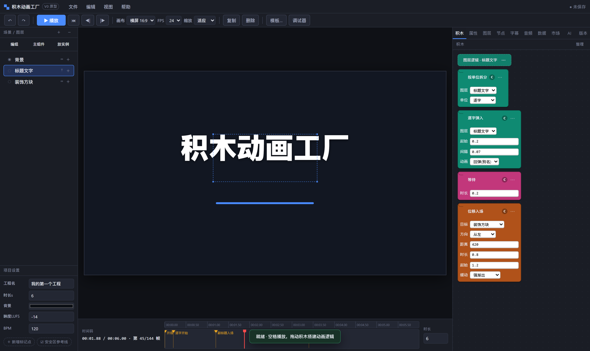
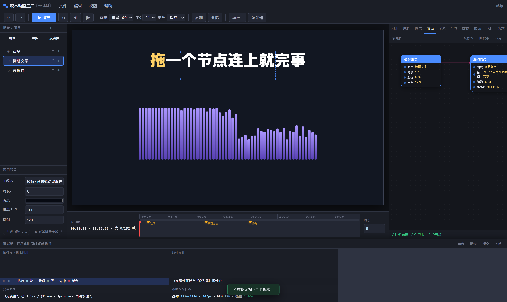
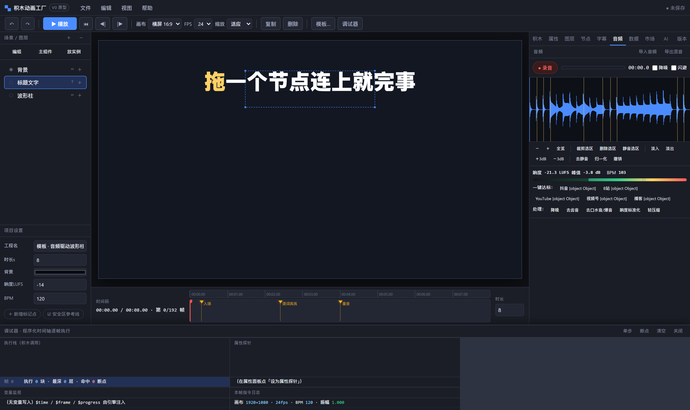
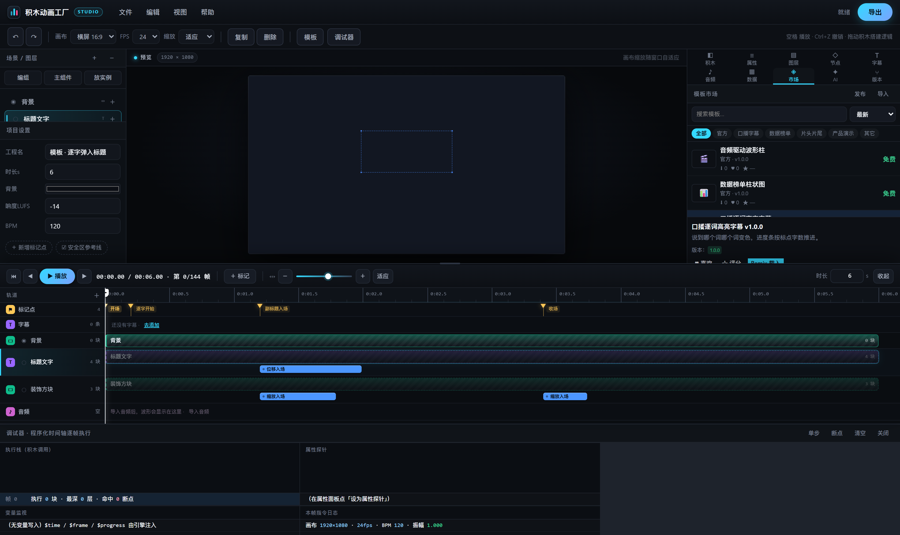
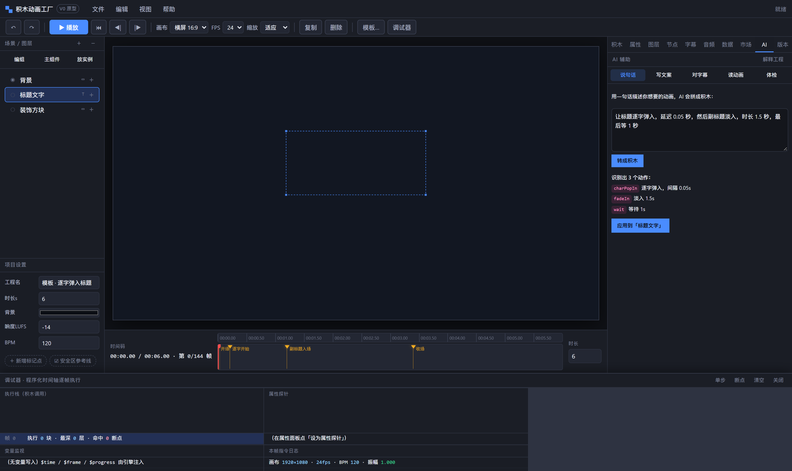
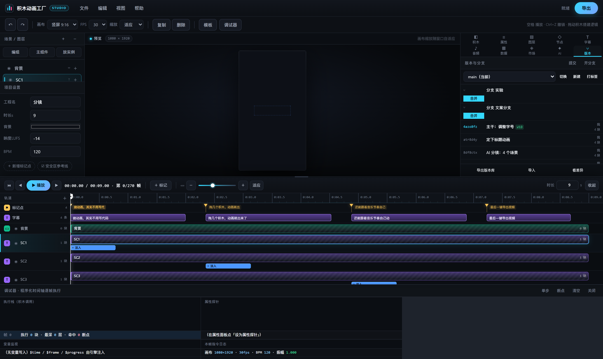

# 积木动画工厂

[](https://github.com/jinyu-yjy-jinyu/block-anim-factory/actions/workflows/ci.yml)
[](https://github.com/jinyu-yjy-jinyu/block-anim-factory/releases/latest)

> 面向短视频与演示创作者的「可视化编程动画工厂」—— 用积木搭动画逻辑，在软件内完成录音、字幕与渲染，全程不写代码、不离开本软件。

按《可视化编程动画制作软件 · 完整功能规划方案》实现，已完成 **P0 / P1 / P2 / V3 / V4** 全部规划项。

---

## 快速开始

本项目是**零构建、零依赖**的纯前端应用（原生 ES Modules），唯一依赖是测试用的 `playwright-core`。

```bash
npm start            # 起本地服务 → http://localhost:5173
npm test             # 跑全部测试（13 个套件）
npm run screenshots  # 生成界面截图到 screenshots/
```

> 必须通过 http 打开，不能直接双击 `file://`——浏览器对 `file://` 下的 ES Module 有跨域限制。

### 桌面版 EXE

不想碰命令行的话，去 [Releases](https://github.com/jinyu-yjy-jinyu/block-anim-factory/releases) 下载，**有两种格式**：

| 文件 | 适合谁 |
|---|---|
| `积木动画工厂-*-win-x64-setup.exe` | 想要「像个软件」：装完有开始菜单入口、桌面图标、卸载入口 |
| `block-anim-factory-win-x64.zip` | 想解压即用 / 放 U 盘里带走，不需要安装 |

安装版装到 `%LOCALAPPDATA%\Programs\积木动画工厂`，**不需要管理员权限**（这也是刻意选的路径，
未签名的程序写 `Program Files` 会弹 UAC，反而更麻烦）。

**第一次打开会看到「Windows 已保护你的电脑」**（SmartScreen）——这是正常的，因为本项目开源、
**不做代码签名**（不买证书）。点「更多信息」→「仍要运行」即可。安装包同理。
源码和完整构建过程都在这个仓库里，可以在 [Actions](../../actions) 页面看每次构建日志。

| | 网页版 | 桌面版 |
|---|---|---|
| 打开方式 | 浏览器打开 `localhost:5173` | 双击 exe |
| 需要什么 | Node.js（或任意静态服务器） | 只要 Windows |
| 工程数据存哪 | 浏览器 localStorage | `%LOCALAPPDATA%\BlockAnimFactory` |
| 导出文件 | 浏览器下载目录 | 系统下载目录 |
| 体积 | 几百 KB | 约 140 MB（自带 .NET 运行时） |

**系统要求**：Windows 10 / 11 64 位 + **Microsoft Edge WebView2 运行时**。
Win11 与较新的 Win10 已经预装；如果双击没反应，去
[developer.microsoft.com/microsoft-edge/webview2](https://developer.microsoft.com/microsoft-edge/webview2/) 装一下。

桌面版壳只有 6 个文件，全部逻辑都在 Web 应用里：

```
desktop/
  BlockAnim.csproj      打包配置：把整个 Web 应用编进 exe
  BlockAnim.cs          释放资源 → 起本地静态服务 → WebView2 加载
  App.xaml(.cs)         入口与全局异常兜底
  MainWindow.xaml       窗口与启动占位
  SmokeTest.cs          冒烟测试（--smoke 模式，不开窗口）
  app.ico               应用图标
```

本地构建（需要 [.NET 8 SDK](https://dotnet.microsoft.com/download)）：

```bash
npm run desktop:build   # → desktop/out/积木动画工厂.exe
npm run desktop:test    # 跑桌面版冒烟测试
```

GitHub Actions 会在每次推 main 时构建桌面产物；当 `package.json` 版本号对应一个新标签时，
自动创建发行版，并把 Windows / macOS / Linux 产物挂上去。

### Electron 桌面壳（跨平台）

WPF 壳只能跑 Windows；Electron 壳（`desktop-electron/`）覆盖 Windows / macOS / Linux，
与 WPF 壳共用同一份 Web 应用，界面与功能完全一致。

| | WPF 壳（`desktop/`） | Electron 壳（`desktop-electron/`） |
|---|---|---|
| 平台 | 仅 Windows | Windows / macOS / Linux |
| 自带运行时 | .NET 8 自包含（约 140 MB） | Electron（体积相近） |
| 本地服务 | C# 裸 `TcpListener` | Node `http`，与网页版共用同一份实现 |
| 状态 | 已发布（安装版 + 便携版） | 已发布（三平台构建，自动挂到发行版） |

核心文件：

```
desktop-electron/
  main.js       主进程：单实例锁 → 起服务（port 0，系统分配）→ 建窗口 → 失败显示可读错误页 → 退出关服务
  preload.js    contextBridge 白名单：isDesktop / platform / saveAs（大文件走系统保存对话框）
  server.mjs    本地静态服务实现（scripts/serve.mjs 与它共用同一份）
  smoke.mjs     云端无头冒烟：app 就绪 / 服务 / 页面加载 / VideoEncoder 真编码一帧 / asar 路径下目录穿越被挡
  test-*.mjs    安全测试：目录穿越、双重编码、asar 虚拟路径边界
  package.json
```

安全基线：`nodeIntegration: false` + `contextIsolation: true`，页面拿不到 `require` / `process` / `fs`；
静态服务只监听回环地址，原始路径里的 `..` 与 `%2e%2e` 这类编码变形一律拒绝；
404 保持纯文本（不吞成 HTML，避免把「文件不存在」伪装成「JSON 解析失败」）。

本地运行（需要先在 `desktop-electron/` 里安装 electron）：

```bash
cd desktop-electron
npm i
npm start              # 起 Electron 窗口
npm run test:server    # 跑服务安全测试
```

> 这套壳仍在施工：状态与待办见「工程侧现状」一节。

### 5 分钟上手

1. 打开后默认载入「逐字弹入标题」模板，按 **空格** 播放。
2. 点左侧「场景 / 图层」选一个图层 → 右侧「积木」页签就是它的逻辑画布。
3. 点积木右上角 **⋯** 插入更多积木；点积木本体选中；拖参数改数值。
4. 点工具条「调试器」，用 **F10 单步 / F9 断点** 看程序化时间轴怎么跑。
5. 右侧「节点」页签可以把同一份积木投影成节点图，点「回积木」验证往返是否无损。
6. 右侧「音频」页签导入音频后，波形编辑器 + 节拍 + 响度一次到位。
7. 「文件 → 导出」选 MP4 / GIF / PNG 序列帧交付成片。

---

## 三个架构决定（规划里最容易做错的地方）

### 1. 积木与节点共用一份 IR ✅

```
积木视图 (Block)  ──┐
                     ├──►  统一 IR（动画 AST）  ──►  编译  ──►  渲染引擎  ──►  导出
节点视图 (Node)   ──┘
```

- `src/ir.js` 定义了全部数据结构，**不含任何求值/渲染逻辑**。
- 积木只是 IR 的一个投影。作用域建模为「子积木列表」，转节点图时**直接等价于一个 Group 节点**，变量读写建模为隐式连线。
- `src/nodegraph.js` 实现双向映射：
  - **积木 → 节点（保真）**：参数槽变输入端口，槽内表达式积木变数据连线，同步兄弟块串成执行流。
  - **节点 → 积木（有损但明示）**：拓扑排序后线性化，无法线性化的结构会在转换报告里逐条列出损失点，**绝不静默丢块**。
- 自测对全部 6 套官方模板的每一层积木做了往返校验，块数与损失均为 0。
- IR 可序列化成**缩进式文本**，便于手写、diff、版本管理，往返无损。

### 2. 编辑态与导出态共用同一套绘图 ✅

`src/renderer.js` 里只有一个 `render(scene, ctx, env)`。编辑态把 canvas 用
`setTransform` 缩放到屏幕并做 DPR 适配；导出态把 canvas 换成成片尺寸。
**差异只有分辨率，没有第二套绘图逻辑**，因此不会出现「预览和成片长得不一样」这个致命问题。

### 3. 声音驱动画面（差异化能力）✅

`src/audiosource.js` 把音频变成**可编程且可寻址**的数据源：

| 取值 | 来源 | 典型用法 |
|---|---|---|
| 实时振幅 `amp` | 真实音轨的包络 / 合成回退 | 文字图形随音量缩放，呼吸感 |
| 低频 `bass` | FFT 频段能量 | 鼓点驱动背景抖动 |
| 中频 `mid` / 高频 `treble` | FFT 频段能量 | 描边随人声点亮 |
| 节拍 `beat` | 自相关检出的节拍点 | 每个节拍触发一次切换 |
| 频谱 `spectrum(t, bins)` | 短时傅里叶 | 波形柱 / 环形频谱 |
| 词级时间码 | ASR 结果 | 卡拉OK逐词高亮 |
| 响度 LUFS | EBU R128 / BS.1770-4 | 上传平台前的一键达标 |

**关键**：所有取值都是 `sample(t)` 的**纯函数**，绝不读 `AudioContext` 的实时播放位置。
所以拖动时间轴能立刻得到正确结果，预览与导出永远一致。

没有真实音频时自动回落到程序化合成包络——画面不会「死」掉，节拍依然可踩点。

---

## 已完成的功能（P0 / P1 / P2）

### P0 · MVP 可用

| 模块 | 文件 | 说明 |
|---|---|---|
| **统一音频内核** | `audio-core.js` | WAV 编解码、FFT、峰值包络、短时频谱、三段频段能量、节拍检测、静音检测、**EBU R128 响度**、响度归一、多轨混音（含闪避）、WSOLA 变速 |
| **录音台** | `recorder.js` | 麦克风录音（含电平表与削波告警）、非破坏波形编辑器（撤销栈）、降噪/去齿音/去口水音/轻压缩预设、变速不变调 |
| **字幕系统** | `subtitles.js` | SRT / ASS / VTT 导入导出、**双语字幕**、逐词时间码、爆字数/重叠/超时校验、字幕锚点驱动场景切分 |
| **统一音源** | `audiosource.js` | 合成与真实音频收敛成同一个接口，踩点吸附、BPM 检测、频谱查询 |
| **视频导出** | `video-export.js` | MP4（H.264，WebCodecs 优先、ffmpeg.wasm 兜底）、GIF、PNG 序列帧、WebM；能力探测与**明确降级提示** |
| **场景树** | `scene.js` | 嵌套组、**复用主组件与实例**（改 master 所有实例同步）、混合模式、遮罩 |
| **文字引擎** | `textengine.js` `layout-rules.js` | 可变字体（字重/字宽/倾斜可动画化）、竖排与纵中横、**环形排版**、**路径文字**、标点避头尾、中文断行；文本表达式（中文数字/千分位/金额/百分比/时长/日期/序数） |

### P1 · 差异化

| 模块 | 文件 | 说明 |
|---|---|---|
| **节点编辑器** | `nodegraph.js` `nodeview.js` | 积木的同源投影，自动布局，保真往返 + 有损报告 |
| **自定义积木** | `customblocks.js` | 函数封装、**宏展开**（改函数体所有调用点同步）、形参替换、递归检测、跨项目积木库、从现有积木一键封装 |

### P2 · 商业化基础

| 模块 | 文件 | 说明 |
|---|---|---|
| **数据驱动** | `batch.js` | CSV/TSV/JSON/在线表格解析、变量插值（`{{列名}}`、`{{列名\|千分位}}`）、条件渲染 |
| **批量渲染队列** | `batch.js` | 数据每行一条、自动命名、**失败重试**、**断点续渲**、并发控制、打包下载 |
| **参数暴露** | `batch.js` | 模板参数化（数值/文本/颜色/开关/选项 + 范围校验），模板生态的地基 |
| **插件 API** | `batch.js` | 插件注册与命名空间隔离、API 版本校验、权限声明与风险审计、事件钩子 |

### V3 · 批量

批量渲染队列（见上）与断点续渲已完成；「本地渲染进程 + 增量渲染」尚未实现，
当前是浏览器内逐帧渲染。

### V4 · 生态

| 模块 | 文件 | 说明 |
|---|---|---|
| **模板市场** | `marketplace.js` | 发布/下架/搜索/筛选/评分/下载统计、**版本历史**（不可变快照）、**一键 Remix**（改参数即出片）、**付费模板与分成记账**、模板包导入导出 |
| **素材库** | `marketplace.js` | 免版权字体/音效/图标/背景/背景音乐，全部标注 CC0；**音效可离线合成**（给出的是参数，运行时合成 PCM，零版权零体积） |
| **AI 辅助** | `ai.js` / `ai-online.js` | 默认离线规则引擎；可选 Ollama 或自定义 OpenAI 兼容接口，见下 |
| **版本与协作** | `collab.js` | 提交/历史/标签/回滚、**分支**、**三方合并**（冲突逐条报出，绝不静默丢弃）、可读补丁 |

#### AI 辅助的五件事

规划 J 列的五条能力都实现了。默认用**离线规则引擎**，也可以在 AI 面板里换成
**Ollama 本地模型（免费）** 或任意 **OpenAI 兼容接口**（自带 Base URL / 模型 / Key）：

| 能力 | 做法 |
|---|---|
| **自然语言转积木** | 中文子句切分 → 动效词表匹配 → 数值/方向/图层抽取 → 编译成**合法积木**。听不懂的片段会明说「没听懂：xxx」而不是瞎猜 |
| **文案自动分镜** | 按标点切句（无标点则按虚词硬切）→ 每场按时长配字幕 → **按内容推荐动效**（数字→滚动、问句→缩放、短句→逐字、长句→打字机） |
| **导入字幕自动对齐** | 字幕条 → 动画积木。有词级时间码走逐词高亮，没有就按字数比例算错峰间隔；每条字幕同时生成标记点 |
| **动画反向解释** | 积木 → 人话（「让标题逐字弹入，从 0 秒开始，每个字间隔 0.05 秒，用 backOut 缓动」）；另外还能**从画面采样反推动效**（采样 24 帧比较透明度/位移/缩放的变化） |
| **工程体检** | 扫一遍指出：没有动画、时长不是帧数整数倍、零时长等待、逐字间隔为 0、重复器过多、音频驱动但只有合成音频 |

> **为什么不默认接大模型**：把「能离线跑、结果确定、积木一定合法」放在第一位。
> 在线引擎是可选项：自然语言转积木与文案分镜可以走模型，模型输出仍会被**逐槽校验**
> （非法 op / 槽位 / 枚举 / 图层直接丢弃，数值与时间强制收窄），再交给同一套编译器；
> 网络失败、超时或输出不合法时**自动回退本地规则**并明示原因。
> 模型返回的「语言 → Action[]」和本地引擎完全同构，后续 Remix、真机校验、反向解释全链路原样复用。

**三种引擎**

| 引擎 | 是否需要联网 | 说明 |
|---|---|---|
| **内置规则引擎** | 否 | 默认。不联网、不上传工程，也不需要 Base URL 或 Key |
| **Ollama 本地模型** | 否（本机回环） | 免费。装好 Ollama 后 `ollama pull qwen2.5:7b`；若被 CORS 拦截，用 `OLLAMA_ORIGINS=*` 启动 Ollama |
| **自定义 OpenAI 兼容接口** | 是 | 填 Base URL、模型名和 Key，请求只发往你填的地址 |

> 密钥只存在本机 `localStorage`（`baf.aiConfig.v1`），**不写入工程文件**，也不会随模板/版本提交上传。
> 在线模式的系统提示词只包含动作目录、图层名、时长等制作上下文；是否发送文案由你点击触发。

---

## 界面

右侧面板十个页签：

| 页签 | 用途 |
|---|---|
| **积木** | 逻辑画布：拖拽、嵌套、参数编辑、表达式编辑器 |
| **属性** | 选中积木/图层的参数 |
| **图层** | 逐层的动画参数（字重、描边、渐变……） |
| **节点** | 积木 ↔ 节点 的同源投影与往返保真报告 |
| **字幕** | 字幕列表、双语编辑、逐词时间码、爆字数告警、SRT/ASS/VTT 导入导出 |
| **音频** | 录音台、电平表、波形编辑器（非破坏）、节拍线、响度与一键达标 |
| **数据** | 数据预览、字段绑定、批量渲染队列与断点续渲 |
| **市场** | 模板市场与素材库（V4）：模板浏览/搜索/发布/版本历史/一键 Remix/付费与分成、素材库 |
| **AI** | AI 辅助（V4）：说句话转积木、文案分镜、字幕对齐、反向解释、工程体检 |
| **版本** | 版本与协作（V4）：提交历史、分支切换与三方合并、标签、回滚、可读差异 |

左侧「场景 / 图层」上方三个按钮：**编组**（可嵌套）、**主组件**（登记可复用节点）、**放实例**。

---

## 测试

`npm test` 依次跑 13 个套件，含数百项纯逻辑断言，另含真实 Chromium 驱动的端到端与像素级画面断言：

| 套件 | 覆盖内容 |
|---|---|
| **纯逻辑自测** | 缓动（端点/单调/无 NaN/别名）、颜色往返、确定性噪声、**IR 文本往返无损**、求值器算术/逻辑/颜色、**时间轴纯函数性**、渲染管线 |
| **音频内核** | WAV 编解码往返、FFT、**K 计权响度**（32k/44.1k/48k 三种采样率一致性 <0.9 dB）、节拍检测、静音检测、波形编辑操作栈、去静默、闪避混音 |
| **统一音源与视频导出** | 合成/真实音频接口一致性、**取值纯函数性**、踩点吸附、格式能力探测、PCM→WAV 封装 |
| **自定义积木** | 函数定义、宏展开、形参替换（含嵌套传递）、**递归检测**、跨项目库往返 |
| **字幕场景文字** | SRT/ASS/VTT 往返（含 ASS 逐词码）、双语、校验规则、场景树（嵌套/实例/不透明度传递）、复用实例同步、文字排版（横排/竖排/环形/路径/断行/避头尾）、文本表达式 |
| **节点与批量** | **积木↔节点往返（全部模板无损）**、拓扑排序与环检测、CSV/TSV/JSON 解析、变量插值、批量队列（重试/断点续渲/并发/取消）、参数暴露、插件注册与权限审计 |
| **V3/V4 市场与 AI** | 模板发布/版本/Remix/付费分成/搜索排序/评分、素材库全 CC0 与音效合成、**AI 五项能力**（转积木/分镜/字幕对齐/反向解释/体检）、版本提交/分支/标签/回滚/三方合并与冲突报告 |
| **管线集成** | **GIF 字节结构逐块校验**、差分压缩、LZW 压力、ZIP 中央目录、全链路渲染 |
| **浏览器端到端** | 真实 Chrome 驱动 14 个场景：加载无报错、UI 骨架、舞台像素非空、播放/逐帧、积木编辑、撤销重做、6 套模板、调试器、**导出 PNG/GIF/ZIP/JSON 并校验文件头**、工程往返、画布预设、图层增删、V1/P2 新面板、**V3/V4 三个新面板** |
| **画面内容断言** | 用像素而非肉眼：标题亮白文字、波形柱数量、柱状图、**环形频谱中心比环带空**（径向剖面）、逐词高亮色、**节点图节点/连线/端口数量**、波形画布采样点、**BPM/响度/峰值读数**、数据表格单元格、场景组与实例 |

### 测试抓到的真实缺陷（节选）

开发过程中每个套件都抓到过真问题，全部已修并加了回归断言：

- GIF 图形控制扩展多写一个字节 → 浏览器从第二帧开始花屏
- `OffscreenCanvas.toBlob` 不存在 → 所有 PNG 导出超时
- `ease('outBounce')` 对 `const t` 参数做 `-=` → `Assignment to constant variable`
- IR 文本解析从 `defaultProject()` 起手 → 导入工程多出 3 个图层
- `fromText` 的 `>` 指令误弹栈 → 嵌套块往返得到 `undefined.op`
- BS.1770 K 计权滤波器的 `a1` 符号搞反 → LUFS 偏差 50 dB。对着官方 48k 表反推出模拟原型（1500 Hz 高架、Q≈0.707、+4 dB）后，三种采样率误差都在 0.9 dB 内
- WAV 编解码缩放不对称 → 往返误差 6e-5
- **场景树迁移时重新生成了 id** → IR 与场景树对不上号，编组/实例/分支合并全线失效
- **场景树按 IR 初始 `visible` 过滤图层** → 靠积木才出现的图层整个消失（2/3 的图层看不见）
- CSV 引号转义与千分位数字解析
- **节点图往返时子块槽只取了第一条执行边** → 嵌套块丢失
- **`fromText` 返回 `{ir, notes}` 而调用方当 IR 用** → 版本库恢复后全为空
- **AI 把 `charPopIn` 的「间隔」写成 time 槽** → 该槽在 `blocks.js` 里声明的是 num

## 已知问题

- **旧工程的「粒子与重复器」参数可能不对**：「粒子与重复器」模板自首个公开版本起
  即为坏的（粒子不动、重复条没有高度），本版已修正模板本身。用旧版本模板保存过的
  工程需重新配置这两个积木的参数，后续版本提供自动迁移。
- **积木嵌套过深时画面会停在当帧**：为防止界面卡死加了帧内步数上限，
  超限时本帧截断并弹出提示；简化嵌套后恢复。
- **音频不随版本回滚**：音频轨道不作版本快照，回滚到旧版本时画面与字幕回退、音频保持当前状态。
- 本项目刚开源，尚未经过真实使用验证。以上已知问题可能在日常使用中还会增加，
  欢迎到 Issues 反馈。

---

## 文件结构

```
index.html                  应用外壳（菜单 / 三栏 / 弹窗 / 十个面板页签）
src/
  ir.js                     ★ 统一 IR：数据结构 + 校验 + 文本序列化
  blocks.js                 积木库定义（10 类 50+ 积木）+ 缓动表
  evaluator.js              ★ 求值器 + 程序化时间轴 + 缓动/颜色/噪声
  renderer.js               ★ 渲染引擎（编辑态与导出态唯一共用实现）
  exporter.js               导出通道：PNG / 序列帧 ZIP / GIF / JSON / 文本
  blockview.js              积木视图：DOM 渲染、拖拽、嵌套、参数编辑
  debugger.js               程序化时间轴调试器（单步/断点/变量/探针）
  templates.js              6 套官方模板

  # —— 音频 ——
  audio-core.js             WAV / FFT / 响度(R128) / 节拍 / 频段 / 混音 / 变速
  recorder.js               录音器 + WaveEditor 非破坏编辑 + 音频预设
  audiosource.js            ★ 统一音源：合成与真实音频的同一接口
  audiodesk.js              录音台与波形编辑器 UI

  # —— 场景与文字 ——
  scene.js                  场景树：嵌套组 / 复用实例 / 混合模式 / 遮罩
  textengine.js             文字排版：可变字体 / 竖排 / 环形 / 路径 / 表达式
  layout-rules.js           中文排版规则：标点避头尾

  # —— 双模态 ——
  nodegraph.js              ★ 积木 ↔ 节点双向映射 + 布局 + 往返报告
  nodeview.js               节点图渲染（DOM + SVG 连线）
  customblocks.js           自定义积木（函数）：定义 / 宏展开 / 跨项目库

  # —— 字幕与数据 ——
  subtitles.js              SRT / ASS / VTT + 样式模板 + 逐词时间码 + 校验
  subpanel.js               字幕面板 UI
  batch.js                  数据源 / 变量绑定 / 批量队列 / 参数 / 插件
  datapanel.js              数据与批量面板 UI

  # —— V3/V4 生态 ——
  marketplace.js            模板市场 / 版本历史 / 分成 / 素材库 / 音效合成
  ai.js                     AI 辅助：NL→积木 / 文案分镜 / 字幕对齐 / 反向解释 / 体检
  ai-online.js              可选在线 AI：Ollama / OpenAI 兼容接口、输出校验、失败回退
  collab.js                 版本库：提交 / 分支 / 三方合并 / 标签 / 补丁

  # —— 导出 ——
  video-export.js           MP4(WebCodecs/ffmpeg) / GIF / PNG序列 / WebM
  gif.js                    自包含 GIF89a 编码器（5-5-5 量化 + 可选有序抖动 + LZW）
  zip.js                    极简 ZIP（CompressionStream deflate-raw）

  styles.css                基础样式
  panels.css                节点图/字幕/音频台/数据 面板样式
  panels-v3v4.css           市场/AI/版本 面板样式

  main.js                   应用装配：UI、事件、撤销栈、导出调度、BlockAnim API
  headless-canvas.mjs       Node 下的 Canvas2D 记录桩（让渲染管线可测）
scripts/
  serve.mjs                 本地开发服务器（服务实现在 desktop-electron/server.mjs，网页版与 Electron 版共用）
  test-all.mjs              一键跑完全部测试（带超时保护）
run-tests.mjs               套件 1：纯逻辑自测
test-audio.mjs              套件 2：音频内核
test-video.mjs              套件 3：统一音源与视频导出
test-custom.mjs             套件 4：自定义积木
test-scene.mjs              套件 5：字幕 / 场景树 / 文字引擎
test-node-batch.mjs         套件 6：节点图 / 数据 / 批量 / 参数 / 插件
test-v3v4.mjs               套件 7：模板市场 / 素材库 / AI / 版本协作
test-pipeline.mjs           套件 8：GIF/ZIP 字节结构 + 全链路
test-markdirty.mjs          套件 9：未保存状态 / 标记点撤销 / 单次导入
test-renderer-img.mjs       套件 10：图片缓存失败重试
test-browser.mjs            套件 11：真实 Chrome 端到端
test-visual.mjs             套件 12：像素级画面内容断言
make-screenshots.mjs        生成界面截图

  # —— Windows 桌面版 ——
desktop/BlockAnim.csproj    桌面版打包配置（.NET 8 + WebView2）
desktop/BlockAnim.cs        释放资源 → 起本地静态服务 → 加载 WebView2
desktop/App.xaml(.cs)       入口与全局异常兜底
desktop/MainWindow.xaml     窗口与启动占位
desktop/SmokeTest.cs        冒烟测试（--smoke，不开窗口）
desktop/installer.iss       Inno Setup 安装包脚本（安装包文件名用纯 ASCII）

  # —— Electron 桌面壳（跨平台）——
desktop-electron/main.js      Electron 主进程：起服务 → 建窗口 → 失败显示可读错误页
desktop-electron/preload.js   contextBridge 白名单：isDesktop / platform / saveAs
desktop-electron/server.mjs   本地静态服务实现（网页版与 Electron 版共用）
desktop-electron/smoke.mjs    云端无头冒烟（CI 用）
desktop-electron/test-*.mjs   安全测试：目录穿越 / 双重编码 / asar 虚拟路径
```

★ = 核心。

---

## 自动化 / 批渲染接口

页面暴露了 `window.BlockAnim`，让脚本不必去点 DOM：

```js
BlockAnim.loadTemplate('popTitle');
BlockAnim.setTime(1.5);
await BlockAnim.renderFramePNG(2.0);          // 离屏渲染单帧 → Blob

// 节点往返
BlockAnim.nodeRoundTrip(layer.blocks);          // → { nodeCount, lossless, losses }

// 字幕
BlockAnim.loadSubtitles(json);
BlockAnim.subtitleSrt();                        // → SRT 文本

// 场景树
BlockAnim.sceneMasters();                       // 已登记的主组件
BlockAnim.sceneFlat();                          // 扁平后的渲染顺序

// 数据
BlockAnim.interpolate('{{产品}} 卖 {{销量}} 台', row);
BlockAnim.scanDataBindings();                   // 重新扫描可绑定字段

// 市场与素材
BlockAnim.market();                             // 模板列表 + 收益
BlockAnim.publishTemplate({ name: '我的模板', price: 1000 });
BlockAnim.remixTemplate(id, { title: '换成我的标题' });
BlockAnim.assets('sfx');                       // 免版权素材（全部 CC0）
BlockAnim.sfx('pop');                           // 离线合成音效

// AI
BlockAnim.aiParse('让标题逐字弹入，延迟 0.05 秒');
BlockAnim.aiStoryboard('第一句。第二句。');
BlockAnim.aiExplain();                          // 整个工程说成人话
BlockAnim.aiInfer();                            // 从画面反推动效
BlockAnim.aiLint();                             // 工程体检
BlockAnim.aiConfig;                             // 当前 AI 引擎（local / ollama / custom）
BlockAnim.setAiConfig({ provider: 'ollama', baseUrl: 'http://127.0.0.1:11434/v1', model: 'qwen2.5:7b' });

// 版本
BlockAnim.repo();                               // 提交历史与分支
BlockAnim.gitCommit('改了什么');
BlockAnim.gitBranch('实验');
BlockAnim.gitMerge('实验');                      // 冲突会逐条报出

// 导出能力
await BlockAnim.capabilities();                 // { canMp4, webcodecs, ... }
```

批量渲染：

```js
await BlockAnim.batchRender(
  [{ name: '一月', value: 30 }, { name: '二月', value: 55 }],
  { time: 1.0, onProgress: (p, row) => console.log(p, row) }
);
```

---

## 时间轴模型：声音是绝对基准

- `evaluateFrame(ir, t, audio)` 是**纯函数**——同一个 `t` 永远得到同一画面。
  因此预览播放、调试单步、导出逐帧三条路径走同一份代码，天然逐帧一致，
  且支持拖动时间轴任意跳转 / 倒放。
- **锚点驱动**：`MARK` 标记点（语音台词 / 节拍 / 字幕边界）是绝对时间基准，
  视觉轨绑定到它而非固定秒数。重录一句配音只要拖标记点，后面所有画面自动重排。
- 积木顺序即时间顺序，无需手拖关键帧。

---

## 内置积木库（10 类）

| 分类 | 能力 |
|---|---|
| 时间轴 | 等待 / 在时间点 / 在标记点 / 之后 / 重复 / 同时执行 |
| 文字 | 显示 / 设置 / 按单位拆分（整块/逐行/逐词/逐字）/ 错峰延迟 / 打字机 / 遮罩擦除 / 路径扫过 |
| 动效 | 淡入 / 淡出 / 位移入场 / 缩放入场 |
| 图形 | 绘制图元 / 设置填充 / 柱状图生长 / 折线图 / 重复器 / 粒子系统 |
| 音频驱动 | 波形柱 / 环形频谱 / 逐词高亮（karaoke） |
| 数学 | 加减乘除 / 取余 / 限制 / 插值 / 帧内插值 / 噪声 / 三角函数 / 当前帧 / 时间 / 进度 |
| 颜色 | 颜色混合 / HSL 取色 |
| 逻辑 | 比较 / 与或非 / 如果…那么 |
| 数组 | 区间随机 / 一维噪声 |

表达式积木（N，返回数值）可嵌进任意槽位；双击槽位打开**表达式编辑器**。

---

## 导出通道

| 通道 | 说明 |
|---|---|
| **MP4（H.264）** | Chrome/Edge 走 WebCodecs 硬件编码，其它环境走 ffmpeg.wasm；不可用时**明确告知降级方案**，不会静默失败 |
| **GIF** | 自带编码器（零依赖、离线可用），宽度上限 640px 保画质 |
| **PNG 序列帧（ZIP）** | 逐帧带 Alpha，可直接导入剪映 / PR |
| **工程 JSON / 积木文本** | 完整 IR / 可 diff 的缩进式文本 |

> 所有格式都调用同一个 `render()`，导出结果与预览逐帧一致。

---

## 快捷键

| 键 | 作用 |
|---|---|
| `空格` | 播放 / 暂停 |
| `,` `.` | 上一帧 / 下一帧 |
| `Ctrl+Z` / `Ctrl+Shift+Z` | 撤销 / 重做（结构变更自动入栈） |
| `Ctrl+D` | 复制选中积木 |
| `Delete` | 删除选中积木（波形编辑器中删除选区） |
| `F10` | 单步执行一帧（调试器） |
| `F9` | 切换选中积木的断点 |
| `Ctrl+滚轮` | 波形缩放 |
| `Esc` | 取消选中 / 关闭弹窗 |

---

## 还没做的

规划里 V0~V4 的功能项都已实现，但下面这些是明确欠着的：

- **本地渲染进程 + 增量渲染**：批量渲染目前是浏览器内逐帧跑；大工程要等很久。
  增量渲染（只重渲改动区间）也没做。
- **云端渲染**：规划里 V3 的付费项，需要服务端。
- **多人实时同步**：现在做的是分支 + 三方合并，能覆盖「你出文案分支、我出动画分支」这类协作，
  但不是 CRDT 那种实时同步。
- **ASR（自动语音识别）**：字幕面板的数据通路、双语、逐词时间码、校验全都有，
  但**语音转文字本身**要接外部服务。
- **在线 AI 的其余能力**：自然语言转积木和文案分镜可走在线模型；字幕对齐、反向解释、
  工程体检仍是本地确定性算法（不消耗额度，也不上传工程）。
- **在线模型的稳定性**：本地小模型可能在复杂句子上给出不合法槽位，这类项会被校验丢弃
  或整体回退本地规则，不保证每个模型都能稳定产出 12 个以内的动作。
- **模板市场的服务端**：市场是本地的注册表，结构上可以换成本地文件或远端后端，
  但目前没有账号体系和真实的支付/结算通道。
- **ffmpeg.wasm 离线打包**：CDN 地址是硬编码的 unpkg，完全离线环境下 MP4 会自动降级到 WebM 或帧序列。
- **Lottie / 交互式 HTML 导出**：规划里列了，没做。
- **macOS / Linux 桌面版**：WPF 壳只支持 Windows；跨平台路线是 `desktop-electron/`，
  已接入 GitHub Actions，由 CI 构建 Windows / macOS / Linux 产物并挂到发行版。

规划里「明确不做的清单」同样被尊重：不碰多轨剪辑与调色、不做专业混音、不做 3D、
不追 Scratch 式趣味、不做移动端。音频只做「录顺的配音 + 剪干净 + 让画面跟着声音走」。

---

## 工程侧现状（2026-10-18 考察摘要）

> 功能层面的欠账见上一节；这里只记「代码库本身」的状态与待办。
> 「工作区改动」指当时尚未提交的改动。

**规模**

| 项 | 数值 |
|---|---|
| 提交数 / 跟踪文件 | 13 个提交 / 91 个文件 |
| 应用代码 | `src/` 34 个文件、约 16,200 行（其中 `main.js` 3,269 行） |
| 测试代码 | 13 个 `test-*.mjs` + `run-tests.mjs`，约 6,270 行 |
| 桌面壳 | WPF 约 1,010 行（已发布）；Electron 约 894 行（已发布，三平台） |
| 运行时依赖 | 仅测试用 `playwright-core`；无构建步骤 |

**工作区改动（2026-10-18 快照，现已并入 main）**

- 新增 `desktop-electron/`（Electron 壳，见「Electron 桌面壳」一节）。
- `scripts/serve.mjs`：本地服务实现抽到 `desktop-electron/server.mjs`，网页版与 Electron 版共用；
  顺带修复 `PORT=0` 从未生效、`PORT=''` / 纯空白 / 非数字会被误当成随机端口的边界问题。
- `desktop/installer.iss` 与 `.github/workflows/desktop.yml`：安装包文件名改为纯 ASCII ——
  中文通配符会让 `upload-artifact` 丢掉文件名前缀（实测产出过以 `-` 开头的文件）；
  用户可见的程序名仍为中文。

**待办 / 风险（工程侧，2026-10-24 更新）**

1. ~~Electron 安全测试硬编码本机绝对路径~~：已改为相对导入，CI 可直接执行。
2. ~~`ci.yml` 源码打包清单缺 `desktop-electron`~~：已补入打包清单。
3. ~~Electron 壳未接线 CI~~：`desktop-electron.yml` 已覆盖三平台打包、冒烟与安全测试。
4. ~~版本号三处手工同步~~：`check-version.mjs` 已覆盖四处（含 `desktop-electron/package.json`），版本升至 0.4.5。
5. **孤儿测试**：`test-mp4.mjs` 仍未接入 13 套件主流程，需单独运行；`test-gif.mjs` 已并入。
6. ~~npm scripts 不全~~：`test:markdirty`、`test:renderer-img` 已补。

**抽样验证**：`npm test` → 13 套件全部通过、无跳过（2026-10-24）。

---

## 与规划书的对应关系

| 规划阶段 | 状态 |
|---|---|
| V0 原型 | ✅ IR、渲染一致性、调试器 |
| V1 MVP | ✅ 场景树、文字引擎、录音与波形裁剪、字幕系统、MP4 导出 |
| V2 双模态 | ✅ 节点编辑器与视图互转、自定义积木、音频驱动动画 |
| V3 批量 | ✅ 数据绑定、批量渲染队列、参数暴露、模板发布与分成（云渲染与增量渲染未做） |
| V4 生态 | ✅ 社区模板市场、AI 辅助、协作与版本管理、插件 API（实时同步与真实支付未做） |

---

## 界面预览

`npm run screenshots` 会在 `screenshots/` 下生成 22 张截图：

| 模板与视图 | 新增面板 |
|---|---|
| 01 初始 · 02 标题弹入 · 03 音频波形柱 | 11 节点图 |
| 04 数据榜单 · 05 环形频谱 · 06 逐词高亮 | 12 字幕面板 |
| 07 调试器 · 08 积木库 · 09 IR 规范 | 13 录音台与波形 |
| 10 竖屏字幕 | 14 数据驱动 · 15 场景树与实例 |
| | 16 导出格式 · 17 模板市场 |
| | 18 AI 转积木 · 19 AI 分镜 |
| | 20 AI 生成的工程 · 21 版本与分支 · 22 AI 读动画 |






